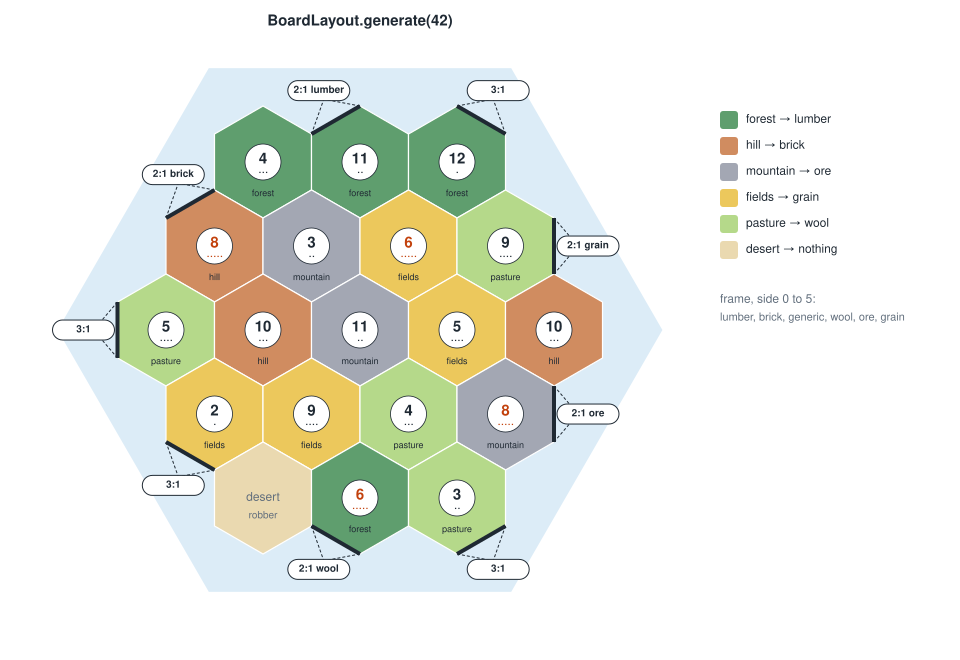

## Settledown

Settledown is a game in the style of CATAN, written in Kotlin Multiplatform for Android, desktop (JVM) and a Ktor
server. The rules engine is Kotlin-first common code, built for a small memory footprint on the JVM.

**Documentation:** start at [docs/README.md](docs/README.md). It covers the hex geometry, board setup, rules engine and
serialization formats, with diagrams and references.

*Settledown is an independent fan project. It is not affiliated with or endorsed by CATAN GmbH. CATAN is a trademark of
CATAN GmbH.*

### Modules

* [/core](./core/src/commonMain/kotlin) holds the game itself, shared by every target:
    - `game`: the board graph (`Hex`, `Vertex`, `Edge`) and layout generation;
    - `game.engine`: the rules engine (`Game`, `Action`, `Phase`, `PlayerView`);
    - `game.codec`: compact binary encodings and replayable game records;
    - `game.random`: the portable, seeded random number generator;
    - `utils`: enum-keyed collections.
* [/app/shared](./app/shared/src/commonMain/kotlin) holds the Compose Multiplatform UI shared by the apps, built
  with Material 3 and drawn entirely in Compose (the board is a `Canvas`):
    - `ui.home`: the start screen, with player count and board preview;
    - `ui.game`: the game screen, board drawing and dialogs, for pass-and-play and online games;
    - `ui.online`: signing in, the lobby and the waiting room;
    - `online`: the client for the server;
    - `ui.theme`: the Material 3 color schemes and the fixed colors of terrain, resources and players.
* [/server](./server/src/main/kotlin) is the Ktor server that runs online games: accounts, room codes and the
  authoritative game. See [docs/server.md](docs/server.md).

### Running the apps

Use the run configurations provided by the run widget in your IDE's toolbar. You can also use these commands and
options:

- Android app: `./gradlew :app:androidApp:assembleDebug`
- Desktop app:
    - Hot reload: `./gradlew :app:desktopApp:hotRun --auto`
    - Standard run: `./gradlew :app:desktopApp:run`
- Server, for local testing: `SETTLEDOWN_DEV_AUTH=true ./gradlew :server:run`

### Running tests

Use the run button in your IDE's editor gutter, or run tests using Gradle tasks:

- Rules engine and codec tests (JVM and Android host): `./gradlew :core:allTests`
- Android tests: `./gradlew :app:shared:testAndroidHostTest`
- Desktop tests: `./gradlew :app:shared:jvmTest`
- Server tests: `./gradlew :server:test`
- Instrumented smoke tests on a connected device: `./gradlew :app:androidApp:connectedDebugAndroidTest`

The UI tests save screenshots: desktop renders go to `app/shared/build/screenshots/desktop`, and device captures to
`app/androidApp/build/outputs/connected_android_test_additional_output` (or
`managed_device_android_test_additional_output` for managed devices). CI uploads both as workflow artifacts.

---

Learn more about [Kotlin Multiplatform](https://www.jetbrains.com/help/kotlin-multiplatform-dev/get-started.html)…