# Settledown documentation

Settledown is a Kotlin Multiplatform game in the style of CATAN. All the game logic lives in
[`core`](../core/src/commonMain/kotlin/com/tgaetaprojects/settledown). It is plain Kotlin in `commonMain`, built to keep
a small memory footprint on the JVM. The apps in [`app`](../app) and the Ktor [`server`](../server) build on it.

These pages explain the ideas behind the code. Use the KDoc for details of individual classes. Most KDoc comments in
`core` link back to the page and diagram that explain them.

## Reading order

| Page | Covers | Main sources |
|------|--------|--------------|
| [Board geometry](board-geometry.md) | Hex coordinates, how corners and sides are named, and how the 19 / 54 / 72 enums are numbered | `Hex`, `Vertex`, `Edge`, `Direction`, `BoardGraph` |
| [Board setup](board-setup.md) | Frame pieces and harbors, the terrain shuffle, and the number spiral | `FramePiece`, `BoardLayout` |
| [Rules engine](rules-engine.md) | Phases, actions, validation, randomness, and what may leave the server | `game.engine`, `game.random` |
| [Serialization](serialization.md) | The bit-packed formats, records and replay, and the version guards | `game.codec` |
| [References](references.md) | The rulebook, hex-grid articles and algorithm papers this code follows | — |

## Diagrams

Every vertex and edge number in these pictures comes from the real enums, through
[`diagrams/geometry.json`](diagrams/geometry.json). See [diagrams/README.md](diagrams/README.md) to redraw them.

| | |
|---|---|
| [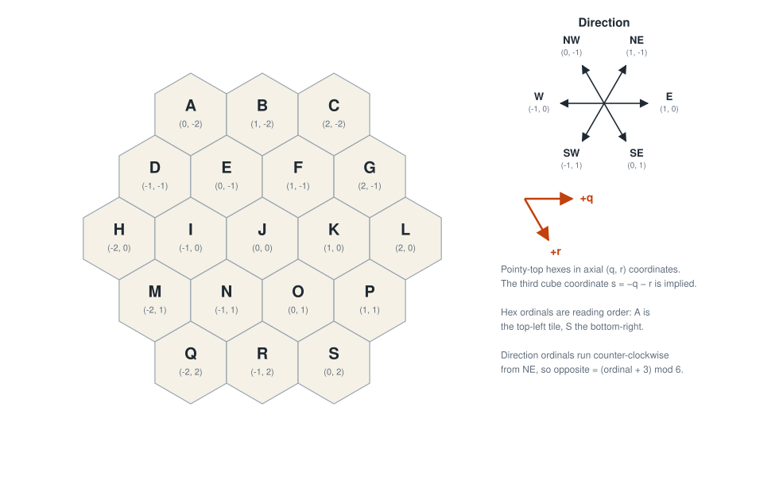](images/hex-coordinates.svg) | [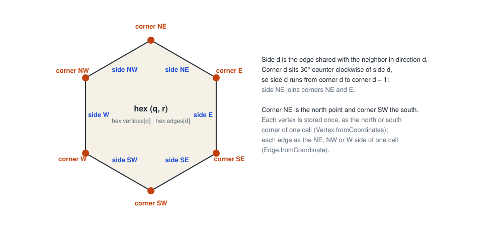](images/hex-corners.svg) |
| [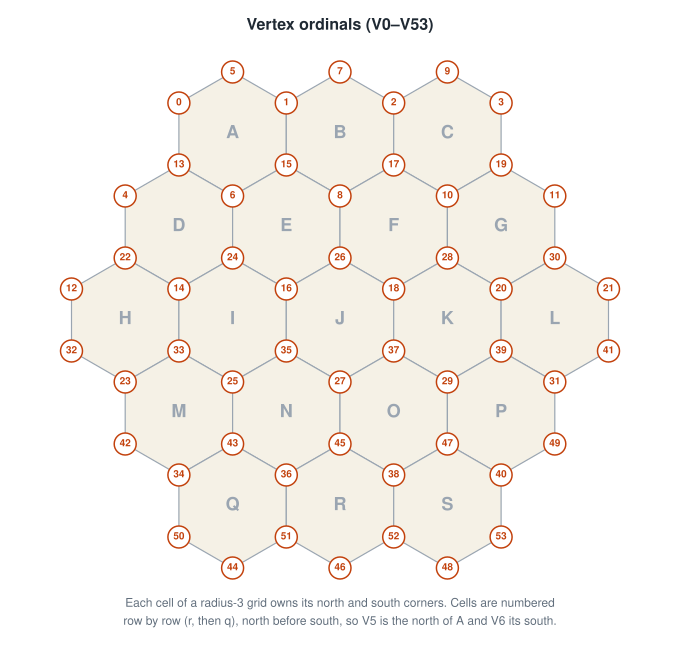](images/vertex-ordinals.svg) | [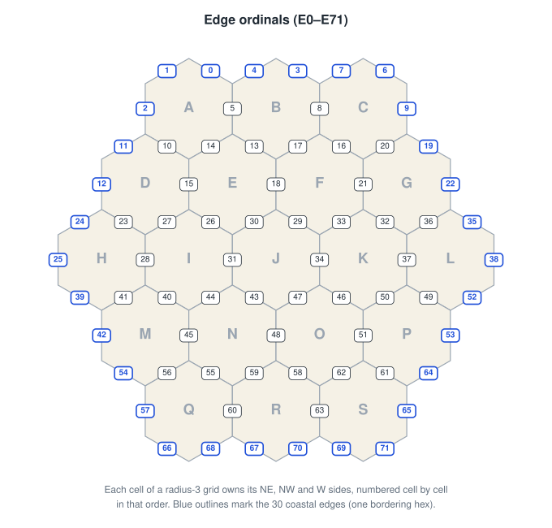](images/edge-ordinals.svg) |
| [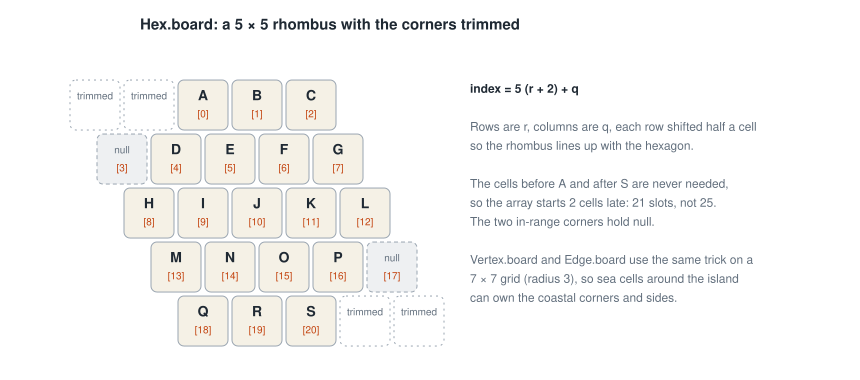](images/hex-storage-grid.svg) | [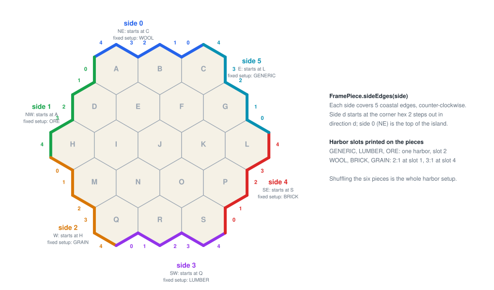](images/frame-sides.svg) |
| [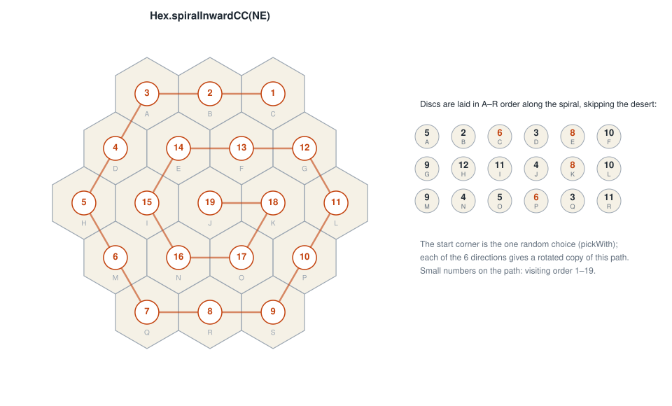](images/number-spiral.svg) | [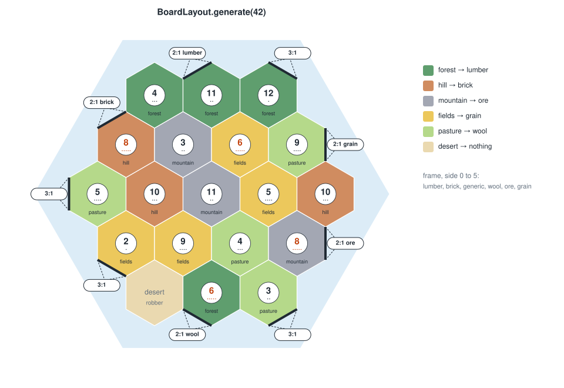](images/sample-board.svg) |
| [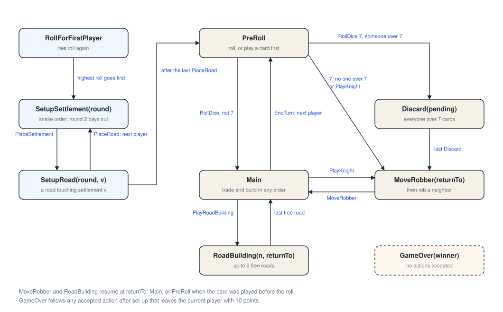](images/engine-phases.svg) | [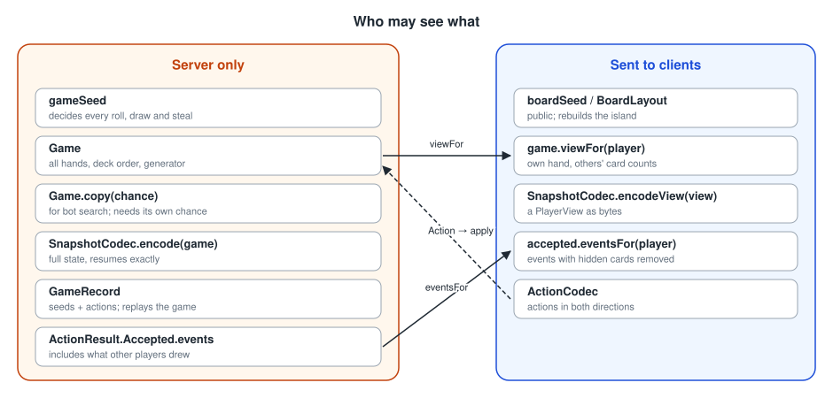](images/trust-boundary.svg) |
| [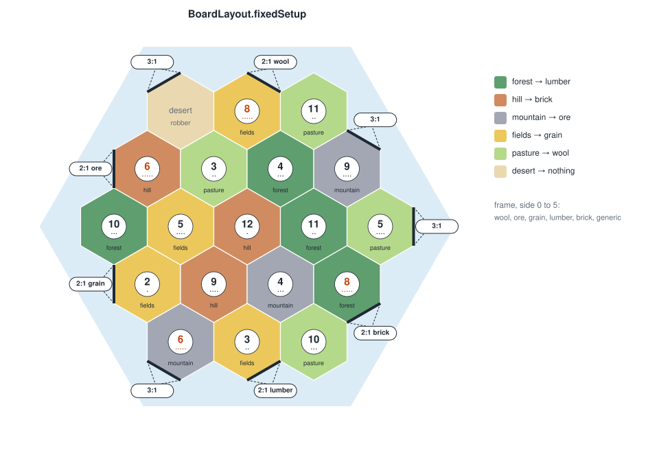](images/fixed-setup.svg) | [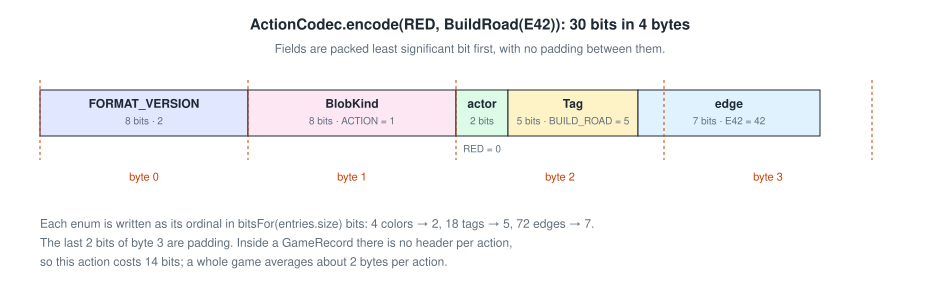](images/action-bits.svg) |

## Diagrams in KDoc

KDoc comments link to these diagrams instead of embedding them. Android Studio's quick documentation can't display
images: its KDoc renderer has no case for Markdown images and escapes raw HTML. It also can't follow relative file
links, so the KDoc links point at the files on GitHub's `main` branch, which open in your browser. Offline, open
these pages in Android Studio's Markdown preview instead, which shows the images.

## The rulebook

The engine follows the 6th-edition base-game rules, *CATAN – The Game*. The publisher hosts the rulebook as a free
PDF. It's linked from [References](references.md) rather than copied here, because the rulebook is copyrighted and
this repository is pushed to GitHub. To keep a copy at hand, put it in `docs/local/`, which git ignores.

