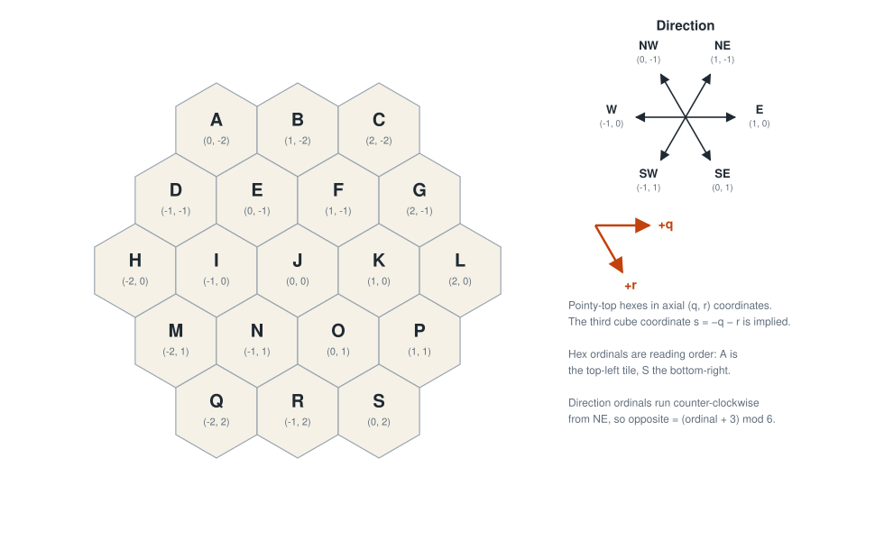
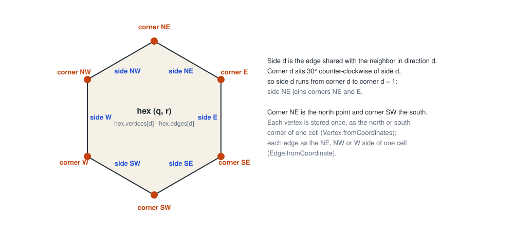
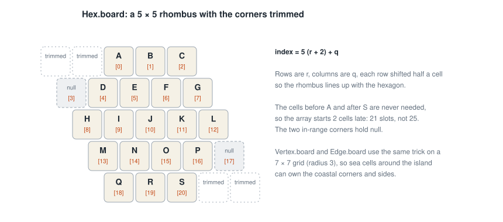
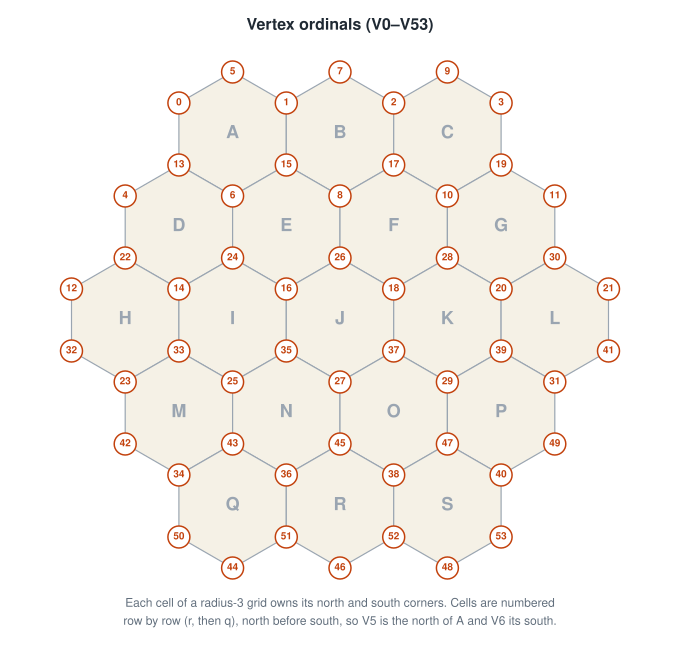
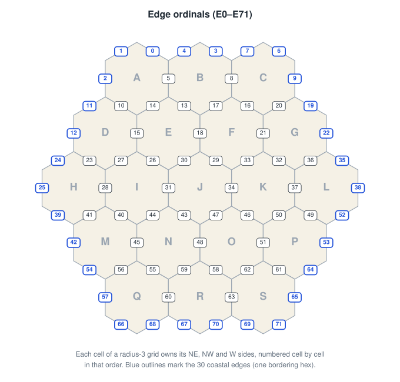

# Board geometry

The island is a hexagon of 19 tiles with radius 2. Three enums describe every place a piece can go:

| Enum | Count | Holds |
|------|------:|-------|
| `Hex` | 19 | terrain, a number disc, the robber |
| `Vertex` | 54 | settlements and cities ("intersections" in the rulebook) |
| `Edge` | 72 | roads ("paths") and harbors |

Their adjacency (`hex.vertices`, `vertex.edges`, `edge.hexes`, …) is computed once by `BoardGraph` and stored in
enum maps and sets indexed by ordinal. Every lookup after that is an array read, and nothing is allocated during play.

## Axial coordinates

Hexes are pointy-top and use **axial coordinates** `(q, r)`: `+q` points east and `+r` points south-east. The third
cube coordinate, `s = −q − r`, is never stored. This is the system Red Blob Games recommends
([axial coordinates](https://www.redblobgames.com/grids/hexagons/#coordinates-axial)), and the formulas in the code
come straight from that article:

| Code | Formula | Red Blob section |
|------|---------|------------------|
| `Direction` | the six neighbor offsets | [Neighbors](https://www.redblobgames.com/grids/hexagons/#neighbors-axial) |
| `AxialCoord.length`, `distanceTo` | `(abs(q) + abs(r) + abs(s)) / 2` | [Distances](https://www.redblobgames.com/grids/hexagons/#distances-axial) |
| `AxialCoord.rotateCC`, `Hex.rotateCC` | permute and negate `(q, r, s)` | [Rotation](https://www.redblobgames.com/grids/hexagons/#rotation) |
| `Hex.isWithinRadius` | `abs(q) + abs(r) + abs(s) ≤ 2·radius` | [Movement range](https://www.redblobgames.com/grids/hexagons/#range-coordinate) |
| `Hex.spiralInwardCC` | ring by ring | [Spiral rings](https://www.redblobgames.com/grids/hexagons/#rings-spiral) |
| `Hex.board` | a trimmed rhombus array | [Map storage](https://www.redblobgames.com/grids/hexagons/#map-storage) |
| the diagrams' layout | `x = √3·(q + r/2)`, `y = 3/2·r` | [Hex to pixel](https://www.redblobgames.com/grids/hexagons/#hex-to-pixel-axial) |

`Direction` ordinals run counter-clockwise from `NE`, so `opposite` is `(ordinal + 3) mod 6` and rotating means
adding to or subtracting from the ordinal.

## Corners and sides of one hex

Sides take their names from the neighbor they face: side `E` is shared with the hex to the east. Corners take the name
of the side 30° clockwise of them, so **corner `d` sits between side `d` and the next side counter-clockwise**:

* corner `NE` is the north point and corner `SW` the south point;
* side `d` runs from corner `d` to corner `d − 1`; for example side `NE` joins corners `NE` and `E`.

`BoardGraph` uses exactly this rule to connect edges to their endpoints. Red Blob's
[grid parts](https://www.redblobgames.com/grids/parts/) article describes the same relations between faces, edges and
vertices in general.

## Storage: padded rhombus arrays

`Hex.fromCoordinate(q, r)` uses no hash map. A radius-2 hexagon fits in a 5 × 5 rhombus of `(q, r)` cells, so the
index is `5·(r + 2) + q` into a 21-slot array: the 25-cell rhombus minus 2 unused cells at each end. The two
corner cells inside that range hold `null`.

`Vertex` and `Edge` use the same trick on a **radius-3** grid (7 × 7). The extra ring of sea cells is what lets every
coastal corner and side have an owner:

* each cell owns two corners, its **north** and its **south**; the other four corners of a hex belong to neighbors;
* each cell owns three sides, its **NE**, **NW** and **W**; the other three belong to neighbors.

The ordinals are handed out by walking those slots in order and skipping any slot that doesn't touch a land hex.
That makes them *geometric ranks*. They are stable for as long as the board shape doesn't change, which is why the
codec can write a vertex in 6 bits and an edge in 7.

## Vertex and edge numbering

Cells are visited row by row (`r`, then `q`), north corner before south. Corners on the same row of the picture
therefore don't get consecutive numbers: `V5` is the north point of `A` and `V6` its south point.

Edges are numbered cell by cell in `NE`, `NW`, `W` order. The 30 coastal edges, the ones with a single bordering hex,
are outlined in blue. Harbors sit on these edges.

## Invariants the tests check

`BoardGraphTest` checks these invariants:

* coordinate lookups round-trip;
* every vertex is a distinct point on the board;
* each edge joins the corners on either side of it, and neighboring hexes agree on the edge they share;
* there are 30 coastal edges;
* 18 vertices touch one hex, 12 touch two and 24 touch three;
* adjacency is symmetric.

The fingerprints in `VersionGuardTest` are built from vertex and edge ordinals. Renumbering the board therefore fails
the tests until `FORMAT_VERSION` and `RULES_VERSION` are bumped.
