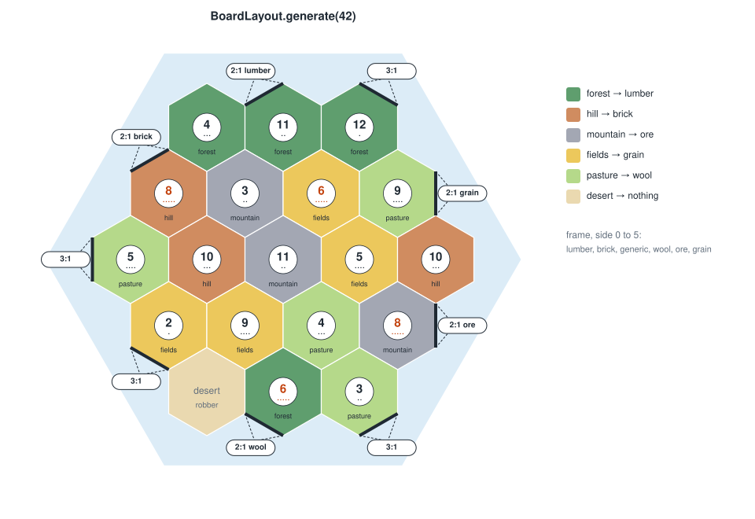
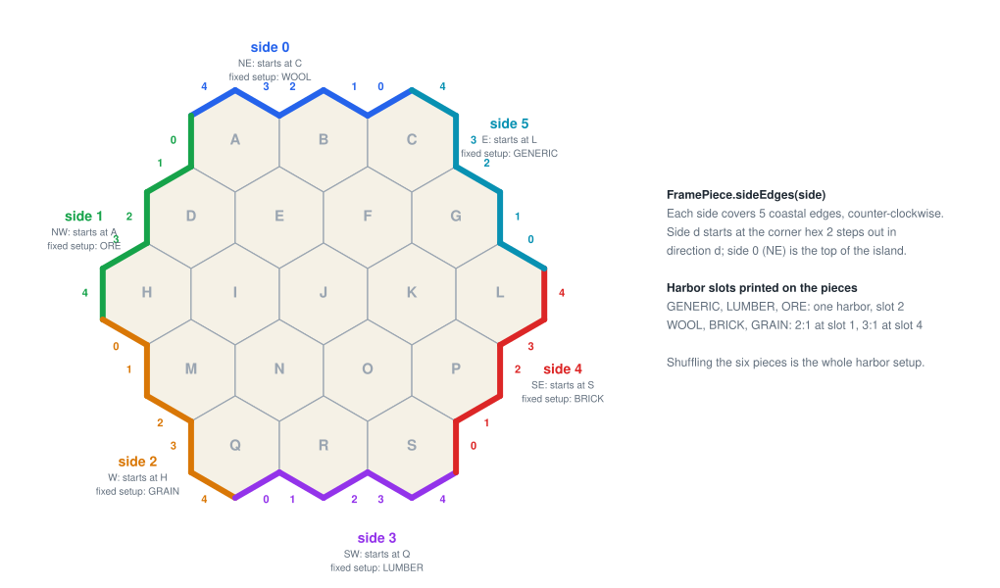
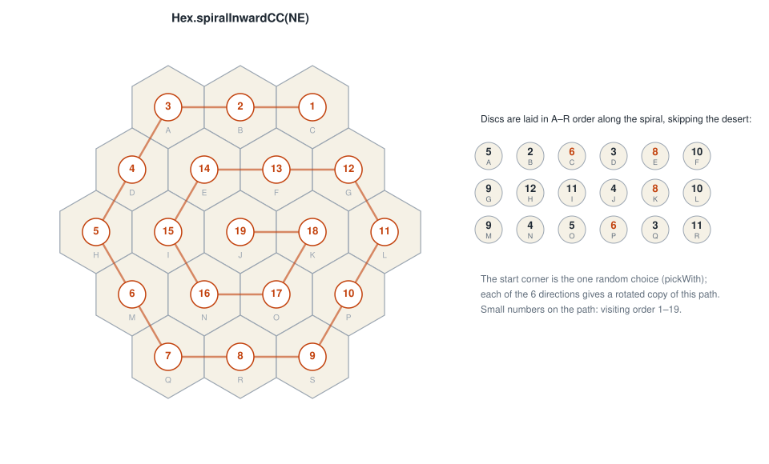
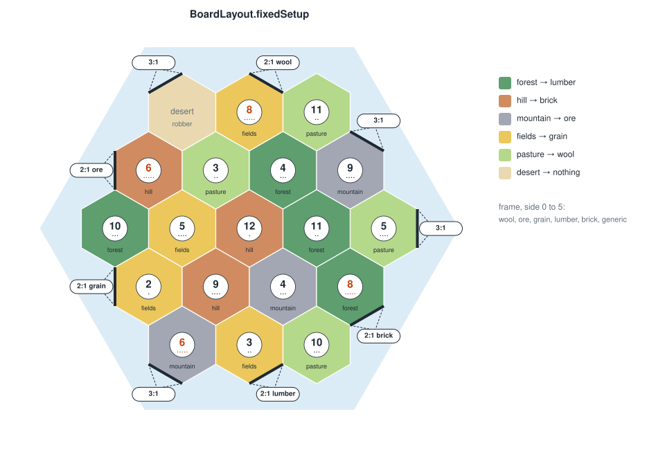

# Board setup

`BoardLayout.generate(boardSeed)` follows the rulebook's *variable setup*. It makes three random draws from a
`GameRandom` seeded with the public board seed, always in this order:

1. shuffle the six sea frame pieces around the island, which places the harbors;
2. shuffle the 19 terrain hexes into place;
3. pick the corner where the number discs start, then lay them along the spiral.

The result never changes during a game. A client that knows the board seed can rebuild the same island, and records
also store the layout itself (21 bytes, see [Serialization](serialization.md)). If the generator changes later, old
games keep their boards.

## Frame pieces and harbors

In the 6th edition the harbors are printed on six sea frame pieces, so harbor setup is just a shuffle of those
pieces. `FramePiece.sideEdges(side)` returns the 5 coastal edges one piece covers, counter-clockwise:

* side `d` starts at the corner hex two steps out in direction `d`; side 0 (`NE`, starting at `C`) is the top;
* a side covers the corner hex's last coastal edge, both coastal edges of the middle hex, then the next corner hex's
  first two.

The pieces carry their harbors in fixed slots:

| Pieces | Harbors |
|--------|---------|
| `GENERIC`, `LUMBER`, `ORE` | one harbor in slot 2: 3:1, 2:1 lumber, 2:1 ore |
| `WOOL`, `BRICK`, `GRAIN` | 2:1 for that resource in slot 1, and 3:1 in slot 4 |

That makes 9 harbors: four 3:1 harbors and one 2:1 harbor per resource. The spacing means no vertex ever touches two
harbors, which `GameBoard.harborAt` relies on. `BoardLayoutTest` checks that the 30 sides chain into one unbroken
counter-clockwise coastline, and that each piece runs from one corner's last edge to the next corner's second edge.

`FramePiece` is declared in the order the pieces connect in the printed frame, counter-clockwise from `GENERIC`:

`GENERIC → WOOL → ORE → GRAIN → LUMBER → BRICK`

The numbers on the puzzle ends give the same cycle. The fixed setup (rulebook page 4) rotates it so `WOOL` is on the
top side, which is the "fixed setup" label on each side in the picture above. The variable setup shuffles the
pieces, so the declaration order doesn't limit which frames can occur. It only decides which frame a given seed
produces, and it's part of both version fingerprints. `BoardLayoutTest` pins it to the rulebook.

## Number discs

The 18 discs are labeled A–R on their backs. They are laid in that order along a spiral that starts at a corner hex
and winds counter-clockwise inward, skipping the desert:

`5 2 6 3 8 10 9 12 11 4 8 10 9 4 5 6 3 11`

`Hex.spiralInwardCC(direction)` precomputes the six possible spirals, one per starting corner. Each is a rotation of
the one pictured. The desert gets `DiceTotal.SEVEN` as a "never produces" marker, since nothing produces on a 7 anyway,
and it is where the robber starts.

This fixed order is what keeps the red 6s and 8s apart. A random number layout would need extra rules to prevent
adjacent 6s and 8s; the spiral needs none.

## The fixed setup

`BoardLayout.fixedSetup` is the rulebook's beginner board (page 4): the printed frame with `WOOL` on top, and a set
arrangement of terrain and discs that doesn't follow the spiral. `BoardLayoutTest` checks its nine harbors against the
edges read off the rulebook artwork.

## Validation

`BoardLayout.of(frame, terrain, numbers)` builds a layout from stored parts. It rejects a frame that doesn't use each
piece once, the wrong terrain tiles or number discs, and a desert without the 7 marker. Decoding a corrupt layout
therefore can't produce an impossible board.
