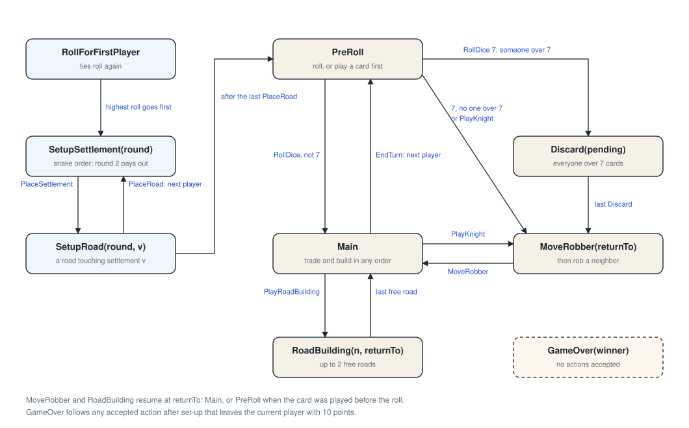
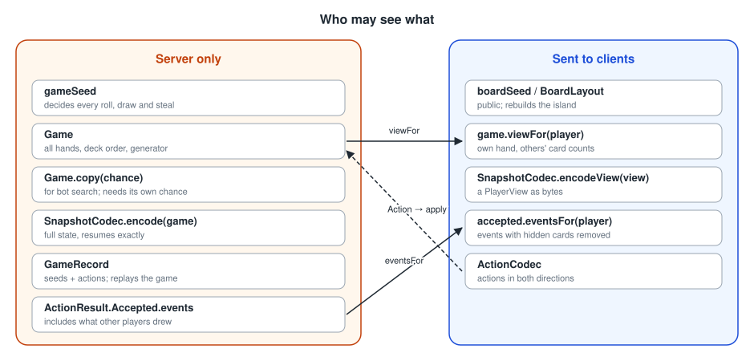

# Rules engine

`Game` runs one game of the 6th-edition base rules with 3 or 4 players. Trading and building happen in one combined
phase after the roll.

## One mutable object, one entry point

All state lives in `Game` and changes in place, only through `apply(actor, action)`. Each action is fully validated
before anything changes. The result is one of two things:

* `ActionResult.Accepted(events)`: the game changed, and `events` says what happened (dice, production, steals, and
  so on);
* `ActionResult.Rejected(violation)`: nothing changed, and `RuleViolation` says why (for example `WRONG_PHASE`,
  `ILLEGAL_LOCATION` or `INSUFFICIENT_RESOURCES`).

Mutating in place keeps the JVM footprint small: no state is copied per action. Bots that want to search ahead use
`Game.copy(chance)` (see below).

## Phases

`Phase` is a sealed interface. Its current value decides which actions are accepted.

* **`RollForFirstPlayer`:** everyone rolls in seat order, and tied highest rollers roll again. The winner starts, and
  play goes clockwise from them.
* **`SetupSettlement`, `SetupRoad`:** a snake draft, `1…n` then `n…1`. The second settlement pays out one card
  per adjacent terrain hex.
* **`PreRoll`:** roll, or play a development card first.
* **On a 7:** every player with more than 7 cards discards half (`Discard`), then the current player moves the robber
  and robs someone (`MoveRobber`).
* **`Main`:** trade and build in any order, then `EndTurn`.
* **`RoadBuilding` and `MoveRobber`:** these carry `returnTo`, so a card played before the roll goes back to
  `PreRoll`.
* **`GameOver`:** a player wins the moment they have 10 points on their own turn, hidden victory point cards
  included.

## Randomness

A game is fully determined by its **seats**, two **seeds** and its **action log**:

| Seed | Decides | Visibility |
|------|---------|------------|
| `boardSeed` | the layout | public; clients rebuild the board from it |
| `gameSeed` | every roll, the deck shuffle and every steal | secret; it never leaves the server |

The two seeds must be drawn independently. If one were derived from the other, a client could recover the dice.

`GameRandom` is xoshiro128++ seeded through SplitMix64, written in plain Kotlin. Its sequence is identical on every
platform and every Kotlin version. The standard library's `Random(seed)` and `shuffle()` make no such promise, so game
code must not use them. Bounded draws use Lemire's unbiased method, and shuffles use Fisher–Yates.

Dice and steals go through the `Chance` interface. A real game uses `SeededChance`, while tests script outcomes.
`Game.copy(chance)` requires a chance source other than the game's own generator, so bot search on the server can
never advance or foresee the real game's rolls.

## What may leave the server

`Game`, its copies, full snapshots and `GameRecord`s all hold secrets: every hand, the deck order and the generator.
Clients get only:

* `game.viewFor(player)`, a `PlayerView` with the whole board, their own cards, and card *counts* for everyone else;
* `accepted.eventsFor(player)`, the events with other players' hidden cards removed;
* the public `boardSeed` or `BoardLayout`.

A bot playing a seat should plan from its `PlayerView`, just like a human client.

## Compact values

`ResourceCounts` and `DevCardCounts` are `@JvmInline` value classes that pack five 5-bit counts into one `Int`. A
hand costs four bytes and never boxes when it's held in a non-null field. Costs are constants
(`ResourceCounts.ROAD`, `SETTLEMENT`, `CITY`, `DEV_CARD`), and trades are subtraction.

## Versioning

`Game.RULES_VERSION` covers the rules, the board generator and the *order in which random numbers are drawn*. A record
only replays on the version that made it. `VersionGuardTest` plays a fixed game, fingerprints the result and fails
if anything changes without a version bump.
