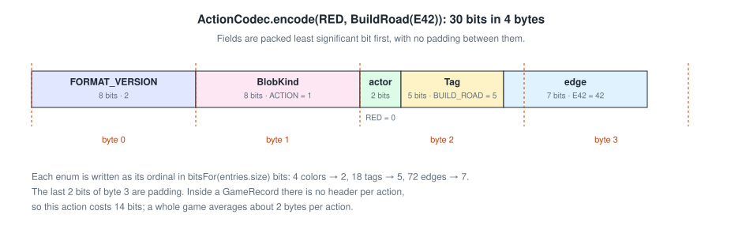

# Serialization

`game.codec` turns game data into small, handwritten binary blobs. They are used for network IO, for bot queries,
and eventually for a game database (SQLite for storage, DuckDB for analysis).

| Codec | Encodes | Typical size | Who may see it |
|-------|---------|-------------:|----------------|
| `LayoutCodec` | a `BoardLayout` | 21 bytes | anyone |
| `ActionCodec` | one `(actor, Action)` | 3–4 bytes; a trade offer about 8 | anyone |
| `SnapshotCodec.encodeView` | a `PlayerView` | a little under a full snapshot | that player |
| `SnapshotCodec.encode` | a whole `Game` | about 150 bytes, at most 200 in tests | server only |
| `GameRecord.encode` | seeds, layout and every action | about 1 KB per game | server only |

## Bit packing

`BitWriter` and `BitReader` pack fields least significant bit first, with no padding between them:

* **Header:** every top-level blob starts with two bytes, `FORMAT_VERSION` and the `BlobKind` ordinal. A decoder can
  reject the wrong kind of blob, or an unknown version, before reading anything else.
* **Enums:** written as their **ordinal** in `bitsFor(entries.size)` bits. That's 2 bits for a color, 6 for a
  vertex and 7 for an edge.
* **Counts:** resource and card counts take 5 bits each.
* **Unbounded numbers:** offer ids and trade lots are varints.
* **Collections:** a claimed count is checked against the remaining bits before anything is allocated
  (`BitReader.count`), so a corrupt length can't cause an out-of-memory crash.

Decoding re-validates everything it can. Values that follow from others, like the bank, pieces left and road
lengths, aren't stored; they're recomputed on decode and checked against the stored state.

## Records and replay

A `GameRecord` stores the rules version, seats, both seeds, the layout and every accepted action. Nothing random is
stored: because the engine is deterministic, replaying the actions rebuilds every position exactly. `replay` refuses
a record from another rules version, or one whose layout doesn't match its board seed. `GameRecorder` wraps a game and
records only accepted actions.

Inside a record, actions have no per-action header. A typical action costs about 2 bytes.

## Versions and guards

| Constant | Bump when |
|----------|-----------|
| `FORMAT_VERSION` | any encoding writes different bytes, including reordering, adding or removing constants in a serialized enum |
| `Game.RULES_VERSION` | a recorded game would unfold differently: rules, board generator, or the order of random draws |

Writing ordinals keeps the codec simple and lets the compiler check that every `when` over the tag enums is
exhaustive. The trade-off is that enum order is part of the format. `VersionGuardTest` guards this:

* it pins fingerprints of fixed samples that use every constant of every serialized enum;
* it pins the size of each serialized enum.

Any change to the stored bytes fails the test until the version is bumped. See the KDoc on `FORMAT_VERSION` for the
list of serialized enums.
